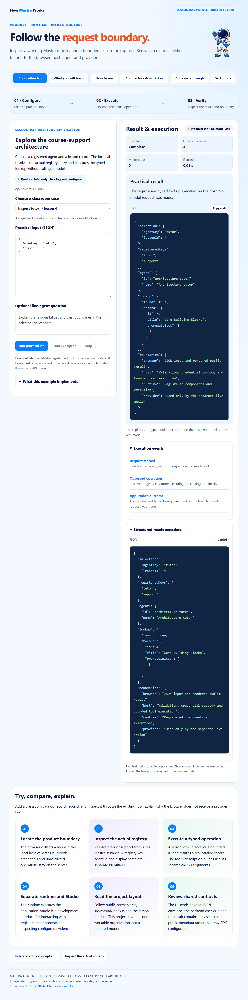

# Mastra · Lesson 02 · Mastra Ecosystem and Project Architecture

Inspect a working Mastra registry and a bounded lesson-lookup tool. See which responsibilities belong to the browser, host, agent and provider.



## Start

Use Node.js 24+. This is an independent repository.

```powershell
git clone https://github.com/luiscoco/Udemy-Mastra-lesson02-app.git
cd Udemy-Mastra-lesson02-app
npm ci
npm start
```

Open http://127.0.0.1:3202. **Run practical lab** executes: Real Mastra registry and tool inspection · no model call. Starting the host makes no model call.

## Five student pages

Application lab · What you will learn · How to run · Architecture & workflow · Code walkthrough. They preserve the approved lesson 1 astronaut, typography, colors, light/dark theme, responsive layout, safe Markdown rendering, syntax colors and copy-code controls.

## Implemented exercise

Choose a registered agent and a lesson record. The local lab resolves the actual registry entry and executes the typed lookup without calling a model.

- **Inspect tutor → lesson 4:** A registered agent and the actual core-building-blocks record.
- **Unknown registry key:** Input validation rejects a key outside the registered contract.

The key-free lab really resolves registered agents and executes a Mastra tool. Live generation is optional. No authentication system, vector store or conversation memory is implemented.

## Optional actual model run

Preserve any existing local configuration. No credential has been copied from another app.

```powershell
if (!(Test-Path .env)) { Copy-Item .env.example .env }
notepad .env
```

Enter your own provider key, choose a model your account can access, and restart. Keys stay on the server and are ignored by Git. Shell values take precedence over the optional file. Live generation may incur provider usage; the normal practical operation does not.

```dotenv
# Set your own provider credential locally. No credential is copied from another app.
OPENAI_API_KEY=your_api_key
MASTRA_MODEL=openai/gpt-4.1-mini
PORT=3202
```

## Build and test

```powershell
npm run sample
npm run sample:live
npm run build
npm test
npm run test:browser
```

The normal sample executes the real key-free operation. The live sample requires provider configuration. Offline SDK integration tests use Mastra's explicit model-test adapter and do not make paid model calls. Browser tests execute the real local lab, navigate all five pages, check responsive behavior and safe code rendering, and capture this app's own preview. Set BROWSER_EXECUTABLE for a nonstandard Chrome/Chromium path.

Source-linked excerpts and the browser script are generated from the actual implementation. Rebuild after editing source. Generated public files and dependency lockfiles are committed for reproducibility.

## Student exercise

Add a classroom catalog record, rebuild, and inspect it through the existing tool. Explain why the browser does not receive a provider key.

## Key source files

- [src/lab.ts](src/lab.ts)
- [src/mastra/index.ts](src/mastra/index.ts)
- [src/mastra/agents.ts](src/mastra/agents.ts)
- [src/mastra/tools.ts](src/mastra/tools.ts)
- [Request host](src/server.ts)
- [Execution envelope](src/runner.ts)
- [Student page generator](scripts/build-pages.ts)

## References

- [Approved lesson 1 baseline](https://github.com/luiscoco/Udemy-Mastra-lesson01-app)
- [Mastra project structure](https://mastra.ai/docs/getting-started/project-structure)
- [Mastra registry](https://mastra.ai/reference/core/mastra-class)

The astronaut, base styles and Prism integration follow the user's approved course assets. Prism's license remains in public/prism-LICENSE.txt. This application's lesson-specific operations, contracts, examples and explanations are tailored to Lesson 2.
